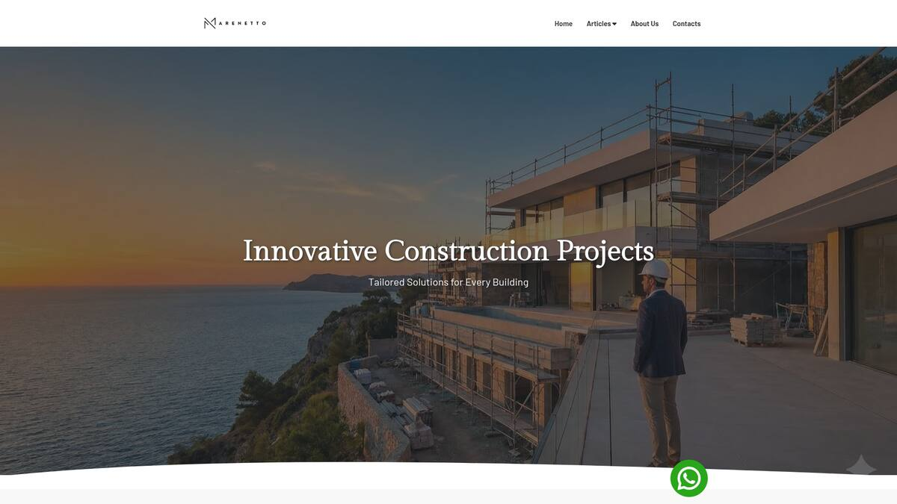
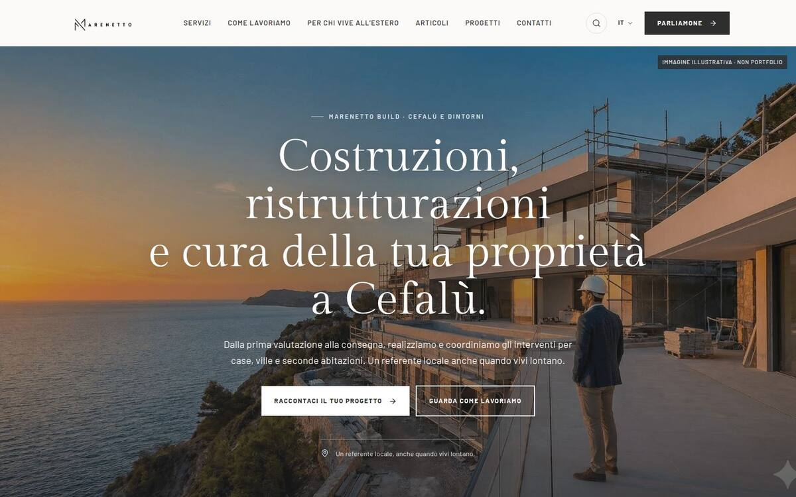

# Marenetto Build — verifica e completamento documentale del Task #42

**Data:** 9 novembre 2026. Le evidenze riportano orari UTC; a Cefalù/Roma aggiungere un’ora.
**Riferimento:** Task #42, “Ricognizione documentata del sito”, unito al progetto nel commit `877075bedf529a208f53a776e36de7510025f411`.
**Natura di questa consegna:** integrazione documentale, non implementazione. Non sono stati modificati sito, contenuti applicativi, traduzioni, configurazioni, schema, account o deployment. Non sono stati inviati moduli, email, telefonate, messaggi WhatsApp o allegati, nemmeno sintetici.

## Sintesi e criterio di lettura

1. Esiste una **traccia positiva del report originale** nella registrazione degli asset del Task #42: HTML e ZIP, con percorso, titolo, dimensioni e impronta. Il precedente riepilogo, limitato alla ricerca dei file locali, non aveva considerato questa traccia.
2. I byte di quei due documenti **non sono stati recuperati** da workspace, riferimenti Git, oggetti irraggiungibili esaminati o accesso anonimo allo storage. Non si conclude che non siano mai esistiti o che siano stati eliminati dalla Library.
3. `.local/` è esclusa dal versionamento. La presente versione consultabile è quindi conservata sotto `artifacts/marenetto-build/reports/task-42/`, fuori dalla directory pubblica del sito.
4. Il dominio aziendale, l’anteprima e la versione pubblicata su Replit sono ambienti distinti. Il codice locale non viene usato come prova del comportamento in produzione.
5. Nel progetto sono presenti 29 registri linguistici e 174 combinazioni delle sei pagine principali. Questo **non equivale a 29 siti interamente tradotti**: la libreria editoriale è italiana, sei stringhe non sono nel catalogo, la pagina 404 è inglese e la qualità semantica di tutte le traduzioni non è stata riesaminata.
6. Nessuna correzione è stata applicata. Le opportunità in E e le stime in F sono proposte descrittive, non lavori avviati.

### Classificazione delle conclusioni

- **D — Verificata direttamente:** lettura di file/storia Git, risposta HTTP, interrogazione in sola lettura o osservazione browser durante questa ricognizione. L’ambiente e il metodo restano parte della conclusione.
- **P — Documentata in precedenza ma non riconfermata:** risultato di un documento o log precedente, non ripetuto in questa fase.
- **N — Non verificabile con gli accessi o il perimetro disponibili:** nessuna deduzione positiva o negativa sul funzionamento.

La presenza di un campo nel codice, un HTTP 200, un catalogo marcato “approved” o un link cliccabile non dimostrano da soli funzionamento completo, traduzione corretta o risultato commerciale.

## Recupero del documento originale e perimetro del Task #42

**D / codice e cronologia Git — 09/11/2026.** Sono stati esaminati:

- la descrizione completa del Task #42 e il piano `.local/tasks/marenetto-ricognizione-documentata.md`;
- i file del workspace, inclusi nomi `REPORT.html`, report, audit, ricognizione e matrici;
- tutti i riferimenti Git locali e remoti disponibili, la cronologia di `.local/reports/` e il contenuto del commit del task;
- 194 oggetti Git irraggiungibili segnalati da `git fsck --full --no-reflogs --unreachable`, senza recuperarvi il report; nessun blob aveva le dimensioni dei due asset registrati;
- `.agents/agent_assets_metadata.toml` e un tentativo di lettura anonima dell’oggetto HTML registrato, concluso con HTTP 403. Non sono state cercate credenziali né aggirate autorizzazioni.

| Asset registrato dal Task #42 | Percorso originario | Dimensione | SHA-256 registrato |
|---|---|---:|---|
| Marenetto Build — Ricognizione documentata | `.local/reports/ricognizione-2026-11-09/REPORT.html` | 1.404.951 byte | `ddcc532e414b52ae7a6eefbb0e4c94bc8eca12a6c9585b2b4e5dd151096b2b50` |
| Report, matrici ed evidenze | `.local/reports/ricognizione-2026-11-09/ricognizione-completa.zip` | 5.106.692 byte | `13a1a2bd538523a93b6cacc243adc195cbc52d11162f0c3b901d00a722705869` |

**Limite N:** la registrazione documenta la consegna di due output, ma il loro contenuto integrale non è oggi leggibile dal filesystem di questa sessione. Il titolo della registrazione descrive sezioni A–F e una matrice CSV di 219 pagine; non si certifica quel contenuto senza averlo recuperato. Potrebbero essere ancora scaricabili dalla Library del task.

**D / Git:** `git diff 877075b^ 877075b --name-only` restituisce soltanto `.agents/agent_assets_metadata.toml`. Non risultano modifiche applicative introdotte dal commit unito del Task #42. Non si può attestare dal diff l’assenza di ogni attività temporanea nell’ambiente isolato, ma non c’è evidenza di una modifica al sito consegnata da quel commit.

Le modifiche a marchio/home/link storici sono nel precedente `234f316`; la localizzazione nel `5aa2da2`; la pubblicazione degli articoli nel `33cd580`; le notifiche Aruba nel `c487e18`. Non sono risultati applicativi del Task #42.

**D / Git:** `.gitignore`, riga 49, esclude `.local/`. Questo spiega perché un documento creato lì non sia necessariamente trasferito insieme ai file versionati. Non è una prova di perdita dallo storage degli asset. Nessuna regola di esclusione è stata cambiata.

Il materiale valido di `MIGRATION_REPORT.md` è riutilizzato e citato, non riscritto come se fosse un nuovo collaudo. Questa consegna integra gli aspetti non consultabili dell’audit originale e indica esplicitamente i limiti residui.

---

## A. Stato attuale e relazione fra gli ambienti

| Ambiente | Fonte e metodo del 09/11/2026 | Stato | Riscontro |
|---|---|---|---|
| Sito aziendale pubblico | GET di `https://www.marenettobuild.com/`, metadati e browser desktop/mobile | D | Sito con risorse, moduli e collegamenti Framework360. Navigazione storica Home/Articles/About Us/Contacts. |
| Domini alternativi | GET di HTTP con/senza www e HTTPS senza www | D | Le richieste del campione terminano su `https://www.marenettobuild.com/`; canonical italiano sullo stesso dominio. La catena dei singoli codici intermedi non è stata conservata. |
| Anteprima Replit | Browser su proxy `http://localhost:80/`, 1440×900 e 390×844 | D | App React effettivamente renderizzata, con servizi, metodo, proprietari esteri, articoli, progetti, ricerca e richiesta. Non è la pagina servita dal dominio aziendale. |
| Replit pubblicato | Metadati di pubblicazione e GET di `https://marenetto-build-sito-e-portale.replit.app/` | D | Pubblicazione pubblica, tipo autoscale, build corrente indicata riuscita; homepage e `/api/healthz` HTTP 200. Non è prova di correttezza di ogni funzione. |
| Codice locale | File sotto `artifacts/marenetto-build`, `artifacts/api-server`, `lib/db` | D | React/Vite, API Express, schemi PostgreSQL/Drizzle, localizzazione a cataloghi, area interna e integrazioni. |
| Archivio storico | `content/source-pages.json`, `content/source-articles-it.json`, `MIGRATION_REPORT.md` | P | Originali acquisiti il 17/10/2026, mantenuti separati dai testi pubblici rielaborati. Non sono una fotografia aggiornata di ogni pagina pubblica. |

### CMS, hosting, repository e pubblicazione

- **D / pubblico:** URL di risorse `assets.framework360.com`, `uploads3.fw360.it`, form `/m/forms/` e collegamenti amministrativi Framework360 sono indizi concordanti dell’uso della piattaforma. Sono elementi della pagina pubblica, non accesso amministrativo al CMS.
- **N / pubblico:** non sono disponibili contratto hosting, pannello DNS/registrar, configurazione server, backup, area geografica o pannello CMS autenticato. Non si deduce il fornitore contrattuale o la regione fisica dai soli header/CDN.
- **D / Replit:** esiste una pubblicazione attiva all’URL sopra indicato. I metadati non riportano il dominio aziendale fra gli URL aggiuntivi. Questo, insieme alla diversa applicazione osservata sul dominio, dimostra che **non è accertata una sostituzione del sito Framework360 con il progetto Replit**.
- **D / codice:** il progetto Replit riusa URL, archivi, loghi e immagini del sito storico, ma aggiunge percorsi, contenuti rielaborati e funzioni interne. È una nuova applicazione con migrazione/ricostruzione, non una copia identica dell’intero CMS.
- **N:** la regione effettiva di hosting, database e storage Replit non è attestata dalle prove raccolte. Non è stata configurata né modificata.
- **D / workspace:** i workflow gestiti web/API segnalano porte già occupate, mentre il proxy serve l’app e l’health endpoint risponde. È una discrepanza di gestione dei processi, non prova che il sito sia irraggiungibile. Non sono stati riavviati processi per “risolverla” durante l’audit.

### Indicizzazione: prove separate

| Ambiente | Evidenza | Conclusione |
|---|---|---|
| Dominio pubblico | GET homepage e `/en/`: nessun meta robots `noindex` nel campione; robots non blocca globalmente il contenuto per `User-agent: *`; sitemap con 27 URL | **D:** contenuti del campione non risultano globalmente esclusi. **N:** effettiva indicizzazione e posizionamento Google, senza Search Console. |
| Anteprima | Meta `noindex, nofollow` nel DOM e `robots.txt` con `Disallow: /` | **D:** esclusione intenzionale presente. La sitemap del dev server restituisce HTML, non la sitemap XML di produzione. |
| Replit pubblicato | GET homepage e URL linguistiche: `noindex, nofollow`; robots `Disallow: /`; sitemap XML con 174 URL | **D:** pubblicazione raggiungibile ma esclusa dall’indicizzazione. Avere una sitemap non annulla il noindex. Non è stata attivata l’indicizzazione. |

### SEO locale: dati e collegamenti accertabili

**D / codice locale `index.html`:** i dati strutturati dichiarano `GeneralContractor` e `Organization`, Marenetto s.r.l. unipersonale, P. IVA IT06471740826, email `info@marenettobuild.com`, telefono `+39 333 936 3007`, SS 113 Settentrionale Sicula 73b, 90015 Cefalù, e area servita “Cefalù e dintorni”. È una dichiarazione nel documento, non un riconoscimento o una qualifica verificati da Google.

**D / pubblico, HTML di `/contatti/`:** sono presenti un collegamento Google Maps di ricerca dell’indirizzo e un embed mappa. Una ricerca Maps non prova il collegamento a una specifica scheda Business Profile verificata, né la disponibilità di recensioni o accesso alla sua gestione. **N:** proprietà del profilo, ranking locale e indicizzazione effettiva, senza accesso ai relativi strumenti.

### Problema dei metadati nella pubblicazione Replit

**D / HTTP senza JavaScript, ore 21:13–21:17 UTC:** `/fr/` e `/en/services` restituiscono nell’HTML iniziale titolo italiano della homepage e canonical alla radice. Le risorse esplicite `/fr/index.html` e `/en/services/index.html` contengono invece titolo e canonical corretti per la pagina.

**D / codice e test locale:** il controllo dei file generati verifica metadati corretti in `dist/public`. **D / anteprima browser:** il campione localizzato aggiorna titolo e contenuto nel DOM. Queste due prove non smentiscono il difetto HTTP sul dominio pubblicato.

**Conseguenza:** i metadati predisposti non vengono necessariamente serviti sull’URL pulita visitata da crawler o anteprime social che non eseguono JavaScript. È una verifica da completare prima di consentire l’indicizzazione, non una correzione effettuata ora. La causa esatta del comportamento del serving non viene dichiarata dimostrata.

---

## B. Inventario delle funzioni, identità e percorsi

### B1. Logo effettivo e varianti

**D / download documentale e confronto SHA-256:** l’asset PNG pubblico senza trasformazioni e `public/brand/current-logo.png` hanno gli stessi byte:

`d4914a3acfff8fdc076747dbde91223f124e336b6c9f56caed4f5bd377d823af`

La composizione visibile è il monogramma M sottile diagonale e la scritta MARENETTO distanziata. Nell’attuale anteprima principale **non è visualizzata la precedente variante con BUILD nella barra colorata**.

| Uso | Asset e formato | Dimensioni intrinseche | Dimensioni visualizzate osservate |
|---|---|---|---|
| Pubblico, navigazione desktop | `https://uploads3.fw360.it/uploads/env/4/15607/img/logos/bg-8fafd03d-5e74-4dce-b4b9-fd878182c53a-1.png`, con trasformazioni CDN | PNG originale 1536×560; immagine trasformata scelta dal browser 1097×400 | Circa 191,97×70 CSS px a 1440×900 |
| Pubblico, navigazione mobile | Stessa famiglia di asset; variante selezionata dal browser WebP/parametri CDN | Come sopra, dipendente da currentSrc | Circa 137,13×50 CSS px a 390×844 |
| Pubblico, footer | Il markup pubblico include lo stesso percorso logo con parametri di ridimensionamento | Originale come sopra | N: rettangolo footer non misurato nel passaggio browser; non dedotto dall’header |
| Anteprima, header/footer desktop | `/brand/current-logo.png`, componente `src/components/brand/Logo.tsx` | 1536×560 | Circa 150,05×62 CSS px per entrambe le istanze; footer sotto la prima viewport |
| Anteprima, header/footer mobile | Stesso PNG e componente | 1536×560 | Circa 110,16×46 CSS px; footer sotto la prima viewport |
| Favicon pubblico | `uploads3.fw360.it/.../img/logos/favicon-32x32.png`; anche touch-icon nel DOM | PNG 32×32 | N: resa nella scheda browser non misurata |
| Favicon anteprima | `public/favicon.svg`, URL `/favicon.svg` | SVG vettoriale, non raster | N: resa nella scheda non misurata |

**D / codice e documentazione del marchio:** `public/brand/design-reference.png` contiene il banner di riferimento con composizione MARENETTO / BUILD.COM. `LogoMark` è un adattamento vettoriale nel codice; non prova che quel segno sia l’originale storico. Il componente `Logo` usato nel sito principale carica invece il PNG storico. Il vecchio banner e l’adattamento non vengono equiparati all’asset effettivo di navigazione.

**N:** originalità giuridica, titolarità e sorgente vettoriale autorizzata delle varianti non sono attestate. La preferenza di Hermannus per la composizione del sito attuale, possibilmente con “.com”, è acquisita: **nessuna sostituzione o ridisegno è stato eseguito**.

**D / risorse e CSS:** Barlow per i testi, Gilda Display per i titoli, superfici chiare, testo antracite, accenti blu ardesia e immagine al tramonto sono riferimenti riconoscibili comuni. L’anteprima mantiene CTA, ricerca, menu e gerarchia dei servizi più articolati. Un’immagine scritta nella console Framework360 non è stata usata come prova del logo visibile.

### B2. Inventario comparato

| Funzione/contenuto | Pubblico storico | Progetto/anteprima Replit | Stato e limite |
|---|---|---|---|
| Navigazione | Home, articoli, chi siamo, contatti | Servizi, metodo, proprietari esteri, articoli, progetti, contatti, ricerca, richiesta | D: presenza e campione di navigazione osservati; non ogni link di entrambi i siti |
| Servizi | Landing e categorie storiche; sitemap 27 URL totali | Sei gruppi: costruzioni/ristrutturazioni, finiture, infiltrazioni, esterni, gestione/manutenzione, pre-acquisto | D: contenuti visibili. Non è una conferma della disponibilità operativa di ogni singolo servizio |
| Articoli | 14 URL italiani; elenco anche inglese osservato | 14 testi italiani rielaborati con fonti e registro di revisione | D: struttura locale e campione browser; P: inventario completo e mappature già in `MIGRATION_REPORT.md` |
| Guide e ricerca | Categorie storiche, alcune documentate vuote | `/guide`, `/ricerca`, archivio con filtri | D: codice; P: funzionamento ricerca/filtri nei test precedenti, non ricollaudati integralmente |
| Progetti e recensioni | Vecchia sezione recensioni con stato vuoto, anche testo italiano in pagina EN | `/progetti` spiega i materiali verificati necessari, non espone casi studio verificati nel codice consultato | D: struttura e campione; nessuna recensione inventata. Non è prova che l’azienda non abbia realizzato lavori |
| Contatti | Form, mail, telefono e WhatsApp | Pagina, footer e richiesta guidata | D: destinazioni ispezionate; N: recapito di messaggi o risposta effettiva, perché non attivati |
| Area interna | Collegamenti amministrativi della piattaforma storica | `/internal`: lead, CMS, notifiche, file e membri secondo permessi | D: codice e configurazione di integrazione; P: test autenticati documentati separatamente; N: nuovo collaudo autenticato in questa fase |
| Area proprietario | Nessuna area operativa provata | `/owner-demo` | D: route e componente dimostrativo nel codice. Non presentato come portale clienti produttivo completo |
| Pagine CMS | CMS pubblico non ispezionato da autenticato | `/content/:locale/:slug`, gestione interna | D: API/UI nel codice; N: stato dei contenuti e permessi reali attuali senza accesso |
| Prenotazioni/newsletter | Newsletter e frammento storico `/translation-ok/` | Nessun calendario operativo provato; frammento escluso | P: motivazione dell’esclusione nel report di migrazione; N: consegna newsletter dal CMS pubblico |

### B3. Moduli, destinazioni e allegati

**D / HTML pubblico, `https://www.marenettobuild.com/contatti/`, ore 21:14 UTC:** il modulo contatti espone nome, cognome, email e messaggio; la newsletter espone nome, cognome ed email. L’action dichiarata è `https://www.marenettobuild.com/m/forms/`. È la destinazione tecnica nel markup, **non il destinatario email accertato**. Il metodo effettivo usato dallo script e la registrazione nel CMS non sono stati collaudati.

**N / pubblico:** destinatari, conservazione, antispam, conferma, recapito ed eventuali allegati gestiti dal CMS non sono stati dimostrati. Nei campi del campione non risultano upload, località o periodo specifici; non si estende questa assenza a ogni modulo possibile del CMS.

**D / anteprima, `/richiesta`, modulo vuoto e codice `App.tsx`:**

- tipologia progetto/lavori, manutenzione o acquisto;
- tipo immobile, servizio, località, fase, messaggio;
- nome, email, telefono, canale e lingua preferiti;
- budget e periodo desiderato facoltativi; opzioni alloggio/mobilità;
- conferma privacy; riepilogo, modifica e invio previsti nell’interfaccia;
- contatto richiesto in base al canale nel codice; limiti di lunghezza e messaggio minimo di 20 caratteri;
- nessun input file nel modulo pubblico.

Il browser ha osservato lo stato iniziale: **non sono stati compilati campi, aperto il riepilogo o provocati errori con invii**. Validazioni, ricevuta e gestione di errore sono quindi D come codice, N come nuovo test end-to-end.

**D / codice API `routes/project-requests.ts`:** validazione Zod, controllo privacy, limite di richieste, chiave di idempotenza, scrittura del lead e notifica persistente. Se non sono soddisfatti i tre gate privacy/fornitori/collaudo, il codice sostituisce l’input con un lead sintetico fisso; non si deve quindi descrivere la demo come raccolta di richieste reali.

**D / codice `lib/aruba-mailer.ts`:** esiste invio SMTP Aruba verso un destinatario configurato; l’invio dipende da modalità dati approvata, lead non sintetico e configurazione SMTP valida. **N:** valore del destinatario e stato effettivo dei gate nei singoli ambienti non sono stati letti, né è stata inviata un’email. La presenza di un secret non prova un recapito funzionante.

**D / UI anteprima:** l’avviso parla di dati sintetici, notifiche interne, email in attesa di approvazione e risposte automatiche inattive. È un messaggio dell’interfaccia, non un controllo indipendente della configurazione del server pubblicato.

**D / codice allegati interni:** sono presenti endpoint di URL di upload, finalizzazione, elenco e download privato protetti da permessi. Il form pubblico non li usa. **P:** `docs/internal-access-verification.md` documenta un precedente PDF sintetico, controlli owner/editor/viewer e revoca. Non sono stati ripetuti upload, login o accessi ai dati.

**D / link registrati senza attivarli:** `mailto:info@marenettobuild.com`, `tel:+393339363007`, WhatsApp verso `393339363007`. L’esistenza del link non dimostra che una conversazione abbia avuto luogo.

### B4. Tre percorsi del visitatore, desktop e mobile

Il campione browser ha osservato home, servizi, proprietari esteri e preparazione richiesta a 1440×900 e 390×844. Le differenze dei tre bisogni sono ricostruite sui contenuti visibili; non sono stati eseguiti tre invii distinti.

| Bisogno | Sito pubblico | Anteprima | Ostacolo concreto / limite |
|---|---|---|---|
| Ristrutturare un bagno | Home/categorie/articoli → contatti o WhatsApp | Home → `/servizi` → `/richiesta`, scelta ristrutturazione | Servizi presentati per gruppi generali; nel campione non c’è un caso bagno prima/durante/dopo verificato. Il visitatore deve descrivere il bisogno senza una prova specifica equivalente |
| Proprietario straniero a distanza | Nove homepage linguistiche osservate e contatti; nessun flusso remoto operativo collaudato | Pagina dedicata `/proprietari-all-estero`, spiegazione comunicazione e referente, poi richiesta | I testi non devono far pensare che `/owner-demo` sia già un’area produttiva per il proprio immobile. Lingua del sito e lingua parlata dal referente restano distinte |
| Manutenzione/intervento specifico | Categoria storica assistenza e contatti | Gruppo gestione/manutenzione e tipo richiesta “Manutenzione” | Nessuna agenda, disponibilità urgente o tempo di risposta accertato. Il sito non va interpretato come servizio di pronto intervento garantito |

Su mobile anteprima il trigger menu è raggiungibile da tastiera e Enter apre i link. Escape non chiude il menu nel campione. I link telefonici/WhatsApp sono stati soltanto ispezionati. La località Cefalù è esplicita, ma la copertura precisa per singolo servizio richiede conferma operativa.

### B5. Prove di esperienza e stati degli articoli

| Stato | Cosa dimostra | Cosa non dimostra |
|---|---|---|
| Conservazione storica | Archivio del testo acquisito e data/URL originari | Attualità, accuratezza o approvazione attuale |
| Rielaborazione | Presenza di un nuovo testo italiano distinto dall’archivio | Che sia la copia letterale della produzione storica |
| Revisione documentale automatizzata | Record IA, data e fonti per 14 articoli in `src/content/articles.ts` | Perizia, verifica in cantiere, approvazione legale/assicurativa o firma professionale |
| Approvazione umana | Richiederebbe un’evidenza identificabile di revisore, ambito e versione | Non deriva automaticamente da `documentary-review` |

**D / codice:** gli articoli indicano “Revisione documentale automatizzata (IA)”, data 09/11/2026 e fonti; il testo pubblico distingue questo controllo da approvazione professionale. **P / report di migrazione:** la scelta di non richiedere approvazione umana è attribuita a una precedente indicazione del titolare; non viene reinterpretata qui come approvazione umana avvenuta.

**D / anteprima:** l’immagine di copertina è etichettata “immagine illustrativa · non portfolio”. **P / documentazione media:** immagini storiche riutilizzate con limiti di provenienza; nessuna autenticazione nuova dei diritti. **N:** fotografie reali di cantieri, sede, personale, mezzi, consenso dei clienti e qualifiche non sono certificati da un’immagine o dal suo nome file.

Non è stato dimostrato un flusso completo per caricare, ordinare e pubblicare foto/video prima-durante-dopo con didascalie, località e autorizzazioni. Un CMS o un upload privato generico non equivale a quella funzione editoriale completa. Eventuali render della sede devono restare distinti da una fotografia della sede esistente.

---

## C. Problemi verificati, conseguenze e priorità

Priorità: **P1** prima di uso operativo/rilascio indicizzabile; **P2** qualità e usabilità da pianificare; **P3** chiarimento/documentazione. Non è una valutazione legale né una certificazione WCAG.

| Priorità | Problema e ambiente | Evidenza del 09/11/2026 | Conseguenza |
|---|---|---|---|
| P1 | Metadati iniziali errati su URL pulite del Replit pubblicato | D / GET `/fr/`, `/en/services`, confronto con i rispettivi `/index.html`; `evidence/published-metadata.json` | Titoli/canonical non corrispondenti per client che non eseguono JS; da risolvere prima dell’indicizzazione |
| P1 | Promesse assolute sulla polizza nel sito pubblico storico | D / estratti HTTP del relativo articolo, sotto | Il visitatore può interpretarle come copertura già garantita senza condizioni. Servono documenti e revisione competente, non una deduzione del report |
| P2 | Sei stringhe non catalogate | D / test locale in sola lettura: 6 controlli passati, 1 fallito | Etichetta del logo e alternative immagini possono restare inglesi nelle altre lingue; il test impedisce di dichiarare copertura integrale |
| P2 | 404 inglese con frase rivolta allo sviluppatore | D / browser `/zz/` e `src/pages/not-found.tsx` | Un visitatore non anglofono trova “Did you forget to add the page to the router?” invece di un aiuto coerente |
| P2 | Menu mobile non chiuso da Escape | D / browser 390×844, Enter apre; Escape lascia `aria-expanded=true` | Riduce la prevedibilità da tastiera. Non viene automaticamente qualificato come violazione WCAG senza audit completo |
| P2 | Stato vuoto recensioni italiano nell’homepage pubblica EN | D / campione browser `/en/`: “Non ci sono contenuti da mostrare” | Interfaccia mista e sezione che non offre prova al visitatore |
| P2 | Ambiguità “materiali locali” nella pagina pietra/prospetti | D / estratti HTTP: Trani/Apricena e “pietre pugliesi” nel contesto di Cefalù | Va chiarita l’area di provenienza e la specifica affermazione, evitando promesse di prestazione non dimostrate |
| P3 | Report originale non trasferito fra file versionati | D / esclusione `.local/`, asset registrati, nessun file recuperato | Una consegna esistente nella Library non è direttamente consultabile dal repository; questa integrazione fornisce una copia documentale persistente, non i byte originali |
| P3 | Workflow web/API segnalati falliti per porte occupate ma proxy operativo | D / log e GET health/proxy | Il solo stato del workflow può indurre a una diagnosi errata. Nessuna correzione infrastrutturale in questa fase |

### Frasi da chiarire: opere in pietra e polizza

**D / sito pubblico, estrazione HTML italiana alle 21:17 UTC**, con contesto completo nei file di evidenza:

`https://www.marenettobuild.com/opere-in-pietra-e-prospetti/`

- “calcareniti locali come la Pietra di Trani o di Apricena”;
- “garantiamo […] la sua perfetta integrità strutturale e idrorepellenza”;
- “Scegliere materiali locali, come le rinomate pietre pugliesi”.

Domande documentali: cosa significa “locali” in questo contesto, quali lavorazioni sono realmente offerte, quali prestazioni sono valutate e da chi? Nessuna conclusione tecnica sul singolo sistema di facciata viene formulata.

`https://www.marenettobuild.com/garanzia-10-anni-sui-lavori-edili-la-polizza-decennale-marenetto/`

- “trasforma un obbligo di legge in una garanzia certa e liquidabile”;
- “Danni a terzi: Copertura per danni causati a proprietà adiacenti […]”;
- “Con Marenetto Build, il rischio è azzerato”;
- “per 10 anni non dovrai sborsare denaro per errori strutturali non dipendenti da te”.

Occorrono condizioni, limiti, esclusioni, opere ammissibili, soggetti e documentazione della polizza applicabile. Il report **non conferma né nega l’esistenza di una polizza** e non dà un parere assicurativo.

L’estrazione inglese del contenuto storico ha inoltre restituito alcuni frammenti di markup; non essendo stata verificata quella specifica resa nel DOM browser, non vengono aggiunti alla tabella come difetti visivi dimostrati. Non vanno confusi con l’HTML italiano direttamente analizzato.

### Le sei stringhe: file, chiavi e preesistenza

**D / codice locale:** tutte in `artifacts/marenetto-build/src/App.tsx`. In `src/localization/catalogs/sources.json` **non esiste una chiave sXXX per queste esatte stringhe**. Le sigle M01–M06 seguenti sono identificatori del report, non chiavi da aggiungere senza revisione.

| ID | Stringa inglese esatta | Posizione attuale / attributo | Impatto |
|---|---|---|---|
| M01 | `Marenetto Build home` | Righe 194 e 226; `aria-label` dei link logo header/footer | Nome accessibile inglese nelle altre lingue |
| M02 | `Illustrative image: contemporary building with scaffolding overlooking the sea at sunset` | Riga 279; alternativa della copertina | Descrizione accessibile non localizzata |
| M03 | `Illustrative image: renovation work on a historic building` | Riga 314; alternativa immagine | Come sopra |
| M04 | `Illustrative image: contemporary villa with a pool, garden and figures carrying out maintenance` | Riga 315; alternativa immagine | Come sopra |
| M05 | `Illustrative image: garden and terrace of a Mediterranean property` | Riga 316; alternativa immagine | Come sopra |
| M06 | `Illustrative image: a stone path being laid among olive trees and stone walls` | Riga 323; alternativa immagine | Come sopra |

**D / storia Git:** tutte e sei sono già presenti nel genitore `234f316` del commit del Task #42. La ricerca `git log --all -S <stringa>` riconduce le cinque alternative immagini al precedente `c924eb2`; l’etichetta home compare anche nella storia del 17/10 (`a3cd380`) e nella successiva risistemazione del marchio. “Preesistenti” significa quindi **preesistenti al Task #42**, non necessariamente anteriori alla localizzazione originaria o presenti da sempre. Nessuna stringa è stata corretta ora.

### Accessibilità e prestazioni: cosa è stato davvero controllato

- **D / manuale assistito da browser:** desktop e mobile, 12 arresti Tab nel campione anteprima con outline calcolato di 2 px; Enter ed Escape sul menu; leggibilità visiva degli screenshot. Non è un test con screen reader.
- **D / browser AR/HE:** `.site-shell` ha `dir="rtl"` e direzione calcolata RTL. Documento e body restano LTR intenzionalmente. Non è un difetto dedotto dal solo `documentElement.dir`.
- **N:** verifica completa del contrasto, zoom 200–400%, screen reader, tutti i controlli, tutti gli errori del modulo e conformità WCAG.
- **N:** nessun Lighthouse, CrUX, PageSpeed o misura di LCP/INP/CLS è stato eseguito. Le durate HTTP nel registro misurano richieste di questo ambiente, non un punteggio prestazionale né esperienza di utenti reali.
- **P:** i log di test precedenti riportano 104 controlli di route riusciti e un avviso bundle oltre 500 kB. Non sono stati rilanciati build o test di route e non se ne deduce la velocità del dominio pubblico.

### Analytics e risultati commerciali

**D / servizio analytics Replit, query SELECT in sola lettura:** accesso autorizzato. Nel periodo degli ultimi sette giorni al momento della query del 09/11/2026, circa 21:11 UTC, risultano **11 record di tipo pageview**, dal 07/11 alle 17:53:36 al 09/11 alle 21:10:50 UTC, e nessun altro tipo di evento nella risposta.

Non sono “11 persone”, conversazioni o richieste qualificate. Il campione può includere visite di collaudo; non viene usato per stime di domanda, conversione o scelta delle lingue. Non è stato calcolato un numero di visitatori unici. Il repository consultato non mostra una strumentazione custom degli esiti aziendali.

**N:** dati GA/Search Console del dominio Framework360, richieste qualificate, preventivi, lavori acquisiti, entrate o tassi di conversione. Nessun account GA/GSC è stato consultato. Il webtracking presente nel sito pubblico non equivale ad accesso ai suoi dati. Il contatore Replit non viene attribuito al dominio aziendale.

---

## D. Informazioni e materiali mancanti da chiedere a Hermannus

Non occorre chiedere di nuovo nome azienda, telefono, email, base a Cefalù, stack locale o preferenza per la composizione storica del logo: sono già disponibili.

| Informazione/materiale ancora necessario | Motivo / limite |
|---|---|
| Copia scaricabile dell’HTML o ZIP originale dalla Library, se ancora disponibile | Recuperare l’esatta consegna precedente e confrontarne prove e matrice di 219 pagine con questa integrazione; non perché sia provato che non fu prodotto |
| Asset sorgente autorizzato della composizione scelta e dell’eventuale variante con “.com” | La preferenza è nota; manca la prova del file finale utilizzabile e dei diritti, non una nuova scelta estetica |
| Condizioni operative e documenti sulla polizza effettivamente proponibile | Le frasi pubbliche non sostituiscono contratto, condizioni e valutazione professionale |
| Confini dei servizi realmente erogati e ruoli dei professionisti incaricati | Evitare di trasformare categorie editoriali in disponibilità, qualifiche o pronto intervento garantiti |
| Uno o più casi reali pubblicabili con località, problema, intervento, foto ordinate e consensi | Il percorso bagno/manutenzione ha bisogno di prove pertinenti, non altre immagini illustrative |
| Provenienza/diritti di foto e video, indicazione esplicita di render o allestimenti futuri della sede | File, persone ritratte e mezzi non provano titolarità o realtà di una sede |
| Evidenza delle approvazioni operative/privacy e destinazione organizzativa delle richieste per ambiente | L’interfaccia demo e il codice dei gate non accertano lo stato del server pubblicato; non sono richieste password o chiavi in chat |
| Piano di passaggio dal CMS storico, controllo DNS e verifica della regione dei servizi | Il dominio pubblico serve ancora un’applicazione diversa; non modificare indirizzamento o indicizzazione sulla base del solo repository |
| Accesso autorizzato a un riepilogo GA/GSC o dati commerciali aggregati con periodo | Per priorità linguistiche e risultati reali; senza questi dati non si stimano conversioni |
| Registro delle revisioni linguistiche per contenuto/versione e capacità di risposta operativa | Il flag `approved-current-copy` non è una revisione semantica rieseguita da questo audit |

---

## E. Opportunità che riutilizzano l’esistente, senza implementazione

1. **Usare un solo inventario delle fonti e delle prove.** Riutilizzare archivi storici, manifest media, registro articoli e questa documentazione, evitando una nuova migrazione parallela.
2. **Mantenere la composizione del logo già in uso.** Eventuale “.com” soltanto dopo ricezione e approvazione del file finale; nessun nuovo ridisegno necessario per proseguire l’audit.
3. **Rendere più preciso il percorso per bisogno.** Collegare gruppi servizi e articoli esistenti a bagno, manutenzione e proprietari esteri, prima di creare nuove pagine generiche. Una scheda reale vale solo con materiali verificati.
4. **Separare interfaccia dimostrativa e canale operativo.** Riutilizzare form, idempotenza, notifiche e mailer; verificare prima messaggi e gate per ogni ambiente. Non ricostruire una seconda gestione lead.
5. **Riutilizzare i cataloghi e il generatore SEO.** Completare i buchi ed esaminare il serving delle URL pulite invece di riscrivere la localizzazione o presumere che un test dei file generati sia prova della pubblicazione.
6. **Collegare CMS e media al processo editoriale reale.** Gli allegati privati già presenti non sono automaticamente un portfolio; eventuale estensione deve gestire consenso, didascalie, ordine, località e stato di pubblicazione.
7. **Misurare esiti distinti, quando autorizzato.** Un click telefono/WhatsApp, una richiesta salvata, una richiesta qualificata e un lavoro acquisito sono eventi diversi. Il piccolo campione di pageview non risponde a queste domande.

### Confronto con quattro imprese pertinenti

**D / webFetch delle homepage, 09/11/2026 circa 21:10 UTC.** Si confrontano elementi osservabili dei siti, non bilanci, organici, certificazioni, proprietà delle foto o conversioni. Le dimensioni sono soltanto apparenti e dichiarate dal sito. Nessun modulo è stato inviato.

| Sito | Pertinenza e dimensione apparente | Percorso di contatto osservato | Presentazione dei lavori | Elemento riutilizzabile per Marenetto |
|---|---|---|---|---|
| [Sicil Impianti](https://www.sicilimpianti.it/) | Srl locale con sede dichiarata a Cefalù; impianti e ristrutturazioni. Organico non verificato | Telefono ripetuto, WhatsApp, contatti e modulo | Fotografie associate a impianti, ristrutturazioni e piscine; autenticità non certificata da questo audit | Raggruppare interventi concreti e contatto vicino al servizio, usando le sezioni già presenti |
| [Edil Sole](https://www.edilsolecostruzioni.com/) | Impresa nominativa di Termini Imerese; dichiara operatività anche Cefalù/Bagheria. Organico non verificato | CTA telefono/contatti e pagine di servizio | Immagini per ristrutturazioni, impermeabilizzazioni, manutenzione e attrezzature; dichiarazioni non trasferibili a Marenetto | Esplicitare zona e tipo di problema; non copiarne garanzie, qualifiche o promesse sui tempi |
| [BM Costruzioni Palermo](https://www.bmcostruzionipalermo.it/) | Presentazione come attività familiare locale di Palermo e provincia. Numero addetti non verificato | CTA “Richiedi un sopralluogo” verso `/contatti` | Sezione “Progetti e lavori realizzati” e pagina specifica ristrutturazione bagno | Associare bisogno, processo e casi pertinenti, senza duplicare il metodo già presente in Marenetto |
| [Lo Vetere Costruzioni](https://www.loveterecostruzioni.it/) | Marchio di impresa con sede dichiarata Palermo e servizi più ampi; non verificata la dimensione societaria | CTA servizi/preventivo verso `/contatti/` | Elenco servizi e fasi del lavoro; affermazioni e contatori richiedono verifica separata | Tenere vicini percorso, responsabilità e contatto; non importare numeri o claim non dimostrati |

Non sono definiti “migliori per conversione”. La sola presenza di foto, testimonianze o contatori non ne dimostra veridicità. Il confronto usa quattro riferimenti siciliani e nessun riferimento estero.

---

## F. Multilingua: copertura effettiva e sostenibilità

### F1. Architettura e stato osservabile

- **D / codice:** `locales.json` dichiara 29 lingue, sei pagine complete ciascuna e `approved-current-copy`. `public-pages.json` contiene 174 percorsi e relativi titolo/descrizione.
- **D / test in sola lettura:** i 27 cataloghi oltre IT/EN hanno le stesse **264 chiavi** del catalogo sorgente, tutte non vuote e con metadati coerenti. IT ed EN sono testi nativi in `App.tsx`, non cataloghi JSON equivalenti.
- **D / test:** questo non intercetta come complete sei stringhe assenti dalla sorgente stessa. Un catalogo “tutte le chiavi presenti” può quindi essere incompleto rispetto alla pagina reale.
- **D / anteprima browser:** campione italiano home/servizi/proprietari esteri/richiesta e 12 combinazioni servizi/richiesta per FR/SV/DA/NO/AR/HE renderizzate con testo e titoli localizzati. **N:** non è stata eseguita la lettura semantica di tutte le 174 pagine in browser.
- **D / pubblico HTTP:** le nove homepage IT/EN/FR/DE/ES/NL/RU/PT/PL rispondono 200 con lingua/titoli coerenti nel campione. Le altre 20 homepage richieste sotto il relativo codice rispondono 404. Questo non certifica la completezza di tutte le altre pagine nelle prime nove lingue.
- **D / codice:** archivio, ricerca, guide, progetti e dettagli editoriali sono nel perimetro italiano. Il catalogo delle sei pagine non comprende automaticamente queste superfici e l’area interna.

### F2. Matrice lingua × contenuti

**Legenda:** `6L` = sei record di pagina/metadati verificati nel codice locale, non sei percorsi integralmente collaudati; `264L` = catalogo locale completo rispetto alle 264 chiavi; `Nativo` = IT/EN in App.tsx; `S,R` = servizi/richiesta osservati in browser; `H,S,A,R` = home/servizi/proprietari esteri/richiesta. `—` = non campionato, non “inesistente”. Le colonne pubblico e anteprima non sono intercambiabili.

| Lingua | Home pubblico HTTP | Pagine principali locale | Campione browser anteprima | Testi modulo locale | Articoli nel progetto | Errori e metadati |
|---|---:|---|---|---|---|---|
| it — Italiano | 200 | 6L, Nativo | H,S,A,R | Nativo; invio N | 14 italiani | UI IT; 404 EN; 6 metadati L |
| en — English | 200 | 6L, Nativo | — | Nativo; invio N | Nessuna edizione EN; alias verso IT | UI EN; 404 EN; 6 metadati L |
| fr — Français | 200 | 6L, 264L | S,R | 264L; invio N | Solo IT | UI catalogata; 404 EN; 6 metadati L |
| de — Deutsch | 200 | 6L, 264L | — | 264L; invio N | Solo IT | Come FR |
| nl — Nederlands | 200 | 6L, 264L | — | 264L; invio N | Solo IT | Come FR |
| es — Español | 200 | 6L, 264L | — | 264L; invio N | Solo IT | Come FR |
| pt — Português | 200 | 6L, 264L | — | 264L; invio N | Solo IT | Come FR |
| ru — Русский | 200 | 6L, 264L | — | 264L; invio N | Solo IT | Come FR |
| pl — Polski | 200 | 6L, 264L | — | 264L; invio N | Solo IT | Come FR |
| ro — Română | 404 | 6L, 264L | — | 264L; invio N | Solo IT | Come FR |
| uk — Українська | 404 | 6L, 264L | — | 264L; invio N | Solo IT | Come FR |
| cs — Čeština | 404 | 6L, 264L | — | 264L; invio N | Solo IT | Come FR |
| sk — Slovenčina | 404 | 6L, 264L | — | 264L; invio N | Solo IT | Come FR |
| sl — Slovenščina | 404 | 6L, 264L | — | 264L; invio N | Solo IT | Come FR |
| hr — Hrvatski | 404 | 6L, 264L | — | 264L; invio N | Solo IT | Come FR |
| sr — Српски | 404 | 6L, 264L | — | 264L; invio N | Solo IT | Come FR |
| bg — Български | 404 | 6L, 264L | — | 264L; invio N | Solo IT | Come FR |
| bs — Bosanski | 404 | 6L, 264L | — | 264L; invio N | Solo IT | Come FR |
| mk — Македонски | 404 | 6L, 264L | — | 264L; invio N | Solo IT | Come FR |
| be — Беларуская | 404 | 6L, 264L | — | 264L; invio N | Solo IT | Come FR |
| ar — العربية | 404 | 6L, 264L | S,R; shell RTL | 264L; invio N | Solo IT | Come FR; shell RTL verificata |
| he — עברית | 404 | 6L, 264L | S,R; shell RTL | 264L; invio N | Solo IT | Come FR; shell RTL verificata |
| sv — Svenska | 404 | 6L, 264L | S,R | 264L; invio N | Solo IT | Come FR |
| no — Norsk | 404 | 6L, 264L | S,R | 264L; invio N | Solo IT | Come FR |
| da — Dansk | 404 | 6L, 264L | S,R | 264L; invio N | Solo IT | Come FR |
| fi — Suomi | 404 | 6L, 264L | — | 264L; invio N | Solo IT | Come FR |
| hu — Magyar | 404 | 6L, 264L | — | 264L; invio N | Solo IT | Come FR |
| el — Ελληνικά | 404 | 6L, 264L | — | 264L; invio N | Solo IT | Come FR |
| tr — Türkçe | 404 | 6L, 264L | — | 264L; invio N | Solo IT | Come FR |

**Comune a tutte le righe:** la conferma di ricezione e l’errore generico sono previsti nel codice ma non provocati durante l’audit; i messaggi API di validazione/rate-limit sono inglesi, mentre il frontend può sostituirli con un messaggio generico localizzato. Non tutte le cause o gli errori nativi del browser sono quindi certificati tradotti. Le sei stringhe mancanti riguardano soprattutto le 27 lingue a catalogo. Il CSV allegato espone anche direzione, nomi, stato dichiarato, chiavi e limiti.

**Metadati pubblicati:** i sei record per lingua sono verificati localmente. Il difetto HTTP delle URL pulite è riconfermato soltanto sul campione FR/home ed EN/services del dominio Replit; non si dichiara che sia stato provato su ogni cella.

### F3. Fallback, switch ed editoria

- **D / `runtime.ts`:** le traduzioni sono JSON locali caricati per lingua, non una traduzione live del visitatore. `translateText` restituisce la stringa sorgente se manca la corrispondenza: può apparire inglese senza errore bloccante. Il controllo strutturale non elimina questo limite.
- **D / codice:** lo switch usa la chiave della pagina principale per costruire l’URL equivalente. **N:** non è stata provata ogni coppia di lingue e pagine. La presenza di etichetta tradotta non prova l’equivalenza di tutta la pagina.
- **D / browser e `historical-routes.ts`:** l’alias esatto `/en/buying-and-renovating-a-house-in-cefalu-a-technical-guide-to-the-5-essential-checks` porta al dettaglio italiano; lingua documento `it` e titolo italiani. `/en/articoli` porta a `/articoli`. È comportamento intenzionale, non un’edizione inglese completa.
- **D:** un precedente tentativo con uno slug italiano semplicemente prefissato `/en/` restituiva 404, ma non era l’alias storico corretto. Non viene presentato come regressione.
- **D / browser:** lingua sconosciuta `/zz/` mostra la 404 tecnica inglese; non c’è un fallback silenzioso a una traduzione completa.
- **D / codice:** i nodi editoriali con lingua originale esplicita sono esclusi dalla traduzione dell’interfaccia. Questo evita di presentare una traduzione automatica dell’articolo come testo approvato.
- **P:** il registro marca le 29 edizioni principali come approvate. **N:** l’audit non autentica revisore, versione e qualità semantica di ciascuna lingua. La revisione automatizzata degli articoli resta un altro processo.
- **D / contenuto anteprima:** viene dichiarato che Herman parla italiano, inglese, olandese e spagnolo. Non è una prova resa da questo audit delle competenze personali, né autorizza a promettere assistenza umana in 29 lingue.

### F4. Proposta sostenibile per almeno dodici lingue

**Proposta, non implementata:** riusare le nove lingue già osservate sul sito pubblico — IT, EN, FR, DE, ES, NL, RU, PT, PL — e i cataloghi già esistenti per SV, DA, NO. Non servono tre nuove traduzioni da zero per le sei pagine principali: quelle tre lingue sono già nel progetto e nel campione browser.

Non si sostiene che siano le dodici lingue commercialmente migliori: mancano dati di domanda qualificata per sostituire questa ipotesi. Non eliminare le altre 17 lingue già predisposte; distinguere “disponibile nel catalogo”, “revisionata per versione”, “pubblicata” e “assistenza disponibile”.

Due perimetri da non confondere:

1. **Nucleo pubblico a dodici lingue:** sei pagine, menu/footer, testi alternativi, modulo, errori/404, ricevute, metadati e switch. Riutilizzare cataloghi, route e generatore; completare le lacune e collaudare la pubblicazione effettiva senza abilitare l’indicizzazione prima del via libera.
2. **Sito interamente a dodici lingue:** anche archivio, ricerca, guide, progetti, articoli, testi legali pertinenti e messaggi operativi. Con 14 articoli oggi solo italiani servirebbero **154 edizioni aggiuntive** per coprire le altre 11 lingue. Per tutte e 29 ne servirebbero **392**. Sono conteggi di versioni, non stime di parole o qualità.

**Dipendenze:** testo italiano stabile; versionamento delle fonti; revisore responsabile per lingua e materia; gestione delle differenze dopo aggiornamenti normativi/tecnici; autorizzazioni sui media; accordo sul perimetro legale e sulle lingue di risposta; collaudo del dominio pubblicato. Aggiungere nuove frasi senza aggiornare sorgente, cataloghi e stato di revisione rende rapidamente non attendibile il flag “complete”.

**Stima indicativa di impegno, non preventivo:** per il nucleo già predisposto, 3–7 giornate-persona di verifica tecnica/editoriale e correzioni circoscritte, più l’attesa dei revisori. Per completare anche la libreria in dodici lingue, prevedere un ordine di grandezza di 20–50 giornate-persona di produzione/revisione distribuite fra competenze linguistiche, tecniche ed editoriali. Le 29 lingue aumenterebbero soprattutto revisione e manutenzione: la sola libreria comporta circa 2,55 volte le versioni aggiuntive del perimetro a dodici. Intervalli da ricalcolare su conteggio parole, revisori e criteri di approvazione; nessuna attività è stata avviata.

---

## Registro delle prove e limiti residui

| ID | Ambiente/fonte | Data e metodo | File consultabile / ambito |
|---|---|---|---|
| E0 | Task, workspace, Git, asset registrati | 09/11, lettura e ricerca senza modifiche | `evidence/recupero.json`; `.agents/agent_assets_metadata.toml`; commit `877075b` |
| E1 | Pubblico / anteprima / Replit pubblicato | 09/11 circa 21:12–21:13 UTC, GET HTTP | `evidence/http.json`: 47 richieste di campione, metadati selezionati e robots; non invii |
| E2 | Browser pubblico e anteprima | 09/11, 1440×900 e 390×844; richieste non GET/HEAD/OPTIONS bloccate | `evidence/browser-evidence-register.json`, `browser-report.md`; screenshot e appendice di correzione |
| E3 | Immagini e marchio | 09/11, copie documentali e confronto byte; screenshot | `logo-public.png`, `logo-preview.png`, favicon, due screenshot desktop e banner ridotto sotto `evidence/` |
| E4 | Codice locale lingue | 09/11, lettura JSON e generazione inventario | `evidence/matrice-lingue.csv`, `.json`; `matrice-lingue-codice.*` |
| E5 | Codice e build già esistente | 09/11, solo `test:i18n` in lettura | `evidence/i18n-test.txt`: sei controlli riusciti e uno fallito; nessuna build nuova |
| E6 | Pubblico, contatti e due articoli | 09/11 21:14 e 21:17 UTC, estrazione HTML | `evidence/public-forms.json`, `public-claims.json` |
| E7 | Documentazione precedente | 17/10 e 09/11 secondo il documento; letta senza ricollaudo completo | `../../MIGRATION_REPORT.md`: inventario 14 articoli, media, alias, esclusioni e motivazioni |
| E8 | Verifiche interne precedenti | Documento datato 09/11; non ripetute | `docs/internal-access-verification.md`: ruoli, revoca, PDF e limiti dei gate temporanei |
| E9 | Quattro siti comparabili | 09/11 circa 21:10 UTC, webFetch | `evidence/competitors.json`: testo estratto, fonte e limiti |
| E10 | Replit analytics | 09/11 circa 21:11 UTC, SELECT aggregata ultimi sette giorni | `evidence/analytics.json`; nessun dato personale o conversione dedotta |
| E11 | Pubblicazione Replit | 09/11, metadati servizio e GET senza JS | `evidence/deployment.json`, `published-metadata.json` |

Le screenshot-reference nel registro browser documentano anche mobile, servizi, richiesta iniziale, RTL, menu e alias. Le due immagini desktop incorporate in questa consegna sono copie persistenti ottimizzate; le altre schermate sono riferimenti della sessione di test, non tutte incorporate come file nel repository.

### Chiusura richiesta

**Dimostrato sul Task #42:** esiste la registrazione di una consegna HTML/ZIP; `.local/` era esclusa da Git; il commit unito modifica soltanto il manifesto degli asset, non l’applicazione. Il contenuto originale completo non è recuperato e non viene descritto come se fosse stato letto.

**Completato documentalmente ora:** documento A–F persistente, ricerca di recupero, separazione degli ambienti, asset/logo/favicon con anteprime, verifica delle sei stringhe e della preesistenza, matrice di tutte le 29 lingue dichiarate con coperture e limiti, campioni browser, confronto di quattro imprese locali, query analytics in lettura e riscontro dei metadati pubblicati.

**Limiti rimasti:** byte dei due output originali; pannello CMS/DNS/hosting e regione dei servizi; GA/GSC; funzionamento delle richieste e SMTP senza invio; stato attuale dei gate e destinatari; nuovo collaudo autenticato; tutte le 174 pagine in browser e loro revisione semantica; audit WCAG/prestazioni completo; diritti e autenticità dei materiali; documenti assicurativi e risultati commerciali.

**Nessuna implementazione, pubblicazione, modifica all’indicizzazione o nuova proposta sulla task board è stata avviata.**
